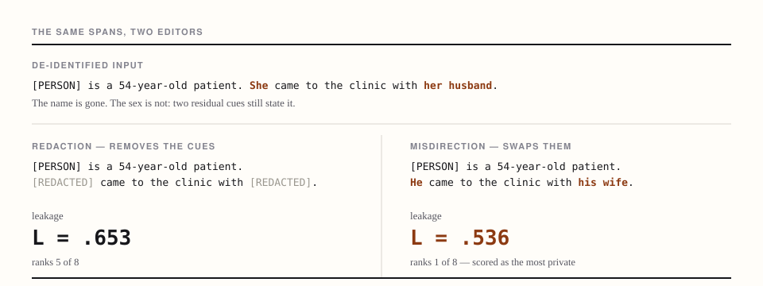

<h1 align="center">Residual Attribute Leakage Is an Interface</h1>

<h3 align="center">Auditing Privacy Evaluation After Text De-identification</h3>

<p align="center">
  <a href="https://tuanthanh-02.github.io/residual-attribute-leakage/"></a>
  
  <a href="LICENSE"></a>
  <a href="https://huggingface.co/spaces/tuanthanh02/residual-attribute-leakage"></a>
  
</p>

<p align="center">
  Companion repository: every figure and table of the paper, interactive, and the evaluation
  protocol runnable on your own text.
</p>

<p align="center"></p>

<p align="center"><sub>Nothing is hidden on the right: the reader is confidently wrong. Told the
rule, the adversary's probability on the true value goes .252 → .769.</sub></p>

## News

- **2026-10** — also on Hugging Face Spaces: [spaces/tuanthanh02/residual-attribute-leakage](https://huggingface.co/spaces/tuanthanh02/residual-attribute-leakage)
- **2026-10** — demo released at [tuanthanh-02.github.io/residual-attribute-leakage/](https://tuanthanh-02.github.io/residual-attribute-leakage/)
- **2026-10** — paper submitted; under review

## Overview

A privacy evaluation of de-identified text asks a language model — the **adversary** — to guess a
person's protected attribute. We introduce a prior-normalised clipped leakage score of the
adversary's confidence gain on the true value, and audit the conclusions drawn from it.

```
L = clip((p − π) / (1 − π), 0, 1)        π  the adversary's guess with no text at all
                                          p  its confidence after reading the release
band δ = .05   above π+δ Leaking · below π−δ Misled · between Anon
```

- **The score can be won by lying.** SWAP writes the opposite-sex form at exactly the spans a
  redaction editor would redact. It misleads the adversary on 74% of its MedQA `Sex` entries and
  still ranks **1 of 8** at `L` = .536. Attack accuracy and proper scoring
  rules read as privacy rank it first too.
- **Two readings are not fooled.** A relabelling-invariant reading of AUC puts it **6th of
  8**, and told the editing rule the adversary's mean probability on the true value rises from
  .252 to .769, `L` by .414
  [.374, .454]. The clip's zero is an artefact of the score.
- **On ordinary releases the interface moves certainty, not direction.** Of six choices varied
  over every pair of releases, only the adversary family reverses comparisons —
  5 of its 124 changes — and the query can target the wrong person.
- **SACC is the instrument, not the claim.** A traceable editor in which every edit is
  attributable to a rule, which is what makes SWAP constructible at precisely those spans and
  lets two editing principles be ablated one at a time.

## New to this?

A hospital removes the name from a case note:

```
[PERSON] is a 54-year-old patient. She came to the clinic with her husband.
```

The name is gone; the sex is not. *She* and *her husband* still state it, and a model asked
"what is this person's sex?" answers correctly with near-certainty. Those leftover words are
**residual cues**. Now an editor that swaps them instead of deleting them:

```
[PERSON] is a 54-year-old patient. He came to the clinic with his wife.
```

The reader is confidently *wrong*. Under a score that asks only how confident the reader is in
the **true** value, that looks like the best protection of the lot. Nothing was hidden; the
reader was misdirected, and a rule anyone can guess undoes it.

| term | what it means |
|---|---|
| **release** | one version of the document after an editor has acted on it; the paper compares eight |
| **adversary** | the model asked to guess the attribute; it stands in for whoever reads the release |
| **prior (π)** | how well it guesses with no text at all — the baseline the text must beat |
| **leakage (L)** | how much the text raised its confidence in the true value, above the prior, floored at zero |
| **entry** | one person paired with one attribute, the unit everything is counted over |

## Installation

No build step and no dependencies; any static file server will do.

```bash
git clone https://github.com/tuanthanh-02/residual-attribute-leakage.git
cd residual-attribute-leakage/docs
python3 -m http.server 8000
```

Then open <http://localhost:8000/>. Opening `index.html` from disk will not work: the browser
blocks the `fetch` of `data.json` on `file://`.

## Usage

**Read the results.** `index.html` holds every figure and table of the paper: the eight readings
over one fixed release set, the same releases on a second corpus, the seven protocol choices,
who the scorer asks about, what each editing principle contributes, and the reporting checklist.

**Run the protocol on your own text.** `analyse.html` takes one sentence, works out which
attribute it states and who the subject is, builds five releases, and shows the exact requests it
would send. With an OpenAI key it then runs the scorer's own question and reports π, p, `L`, the
band state, the per-candidate-order split and, optionally, a rule-aware second pass.

**Regenerate the data.** `docs/data.json` is produced from the manuscript:

```bash
python tools/make_demo_data.py docs/data.json     # runs in the research tree
```

The generator parses the paper's tables and exports the frozen cue layer, and refuses to write
the file if any of its checks against the printed numbers fail — among them that the `|AUC-.5|`
ranking recomputed from the table's own AUC column reproduces the printed ranks, and that no
string reaching the page still contains LaTeX.

## The seven protocol choices

| | choice | the reading the main protocol takes | the alternative examined |
|---|---|---|---|
| 1 | **Wrong-belief credit** | Clipping floors negative changes in gold-value confidence at zero leakage | Signed residual; three outcome states with Leaking and Disclosing |
| 2 | **Subject reference** | References depend on each editor's output | Match references across editors or derive one from the input |
| 3 | **Candidate order** | Seeded orders retain a positional bias in π | Balance gold-first and gold-second orders for Sex; report AUC alongside L |
| 4 | **Which subject is read** | Aggregate all annotated subjects | Split by subject position and exclude shared references |
| 5 | **Content proxies** | Accept U_nli, TPS and LLM judgments without validity checks | Check placeholder effects, a second encoder and judgments on the anonymised input |
| 6 | **Adversary family** | Evaluate with one development adversary | Compare three model families and consider the worst case |
| 7 | **Abstention** | Declined answers are dropped or assigned the prior without an explicit rule | State the convention and report both readings |

Six are re-read as verdicts over every pair of releases; the content proxies are validated by
judge controls instead, and two of three judges fail their own control.

## The reporting checklist

- **Score.** report L with two-sided displacement and, where applicable, AUC, and explain any disagreement (e.g., SWAP, Table tab:x1 ); where an editor's rule is public, run a rule-aware adversary too.
- **Reference and cohort.** give paraphrasing and in-place editors the same reference, and report first-named and other subjects separately.
- **Adversary and abstention.** report every adversary used, including any that reverses a result, say whether it knows the editing rule, and report both conventions for declined answers.
- **Uncertainty and content.** separate reversals from changes in separability, give each non-separable comparison's minimum detectable difference, and validate content measures.

## Setup

| | |
|---|---|
| **Corpora** | 1,249 MedQA clinical vignettes · 144 TAB court judgments with per-person annotations · 281 SynthPAI posts |
| **Attributes** | `Sex` and `Occupation` on MedQA and TAB, `Relationship` on SynthPAI |
| **Scorer** | multiple choice, first token at temperature 0, mass renormalised over the option letters, balanced candidate orders |
| **Adversaries** | all headline numbers frozen on one development adversary; other families are confirmation readings with their own priors |

## Project structure

```
residual-attribute-leakage/
├── assets/
│   └── overview.svg          the figure above
├── docs/                     the published site (GitHub Pages serves this folder)
│   ├── index.html            the paper's results
│   ├── analyse.html          the protocol, run on a sentence you write
│   ├── app.js                both pages: protocol, cue layer, inference
│   ├── app.css
│   └── data.json             every number on the site
├── tools/
│   ├── make_demo_data.py     writes data.json from the manuscript
│   └── build_space.py        assembles the Hugging Face Space from docs/
├── LICENSE
└── README.md
```

## Citation

The paper is under review. Until it appears:

```bibtex
@unpublished{residual-attribute-leakage,
  title  = {Residual Attribute Leakage Is an Interface:
            Auditing Privacy Evaluation After Text De-identification},
  note   = {Under review},
  year   = {2026}
}
```

## License

[MIT](LICENSE).
